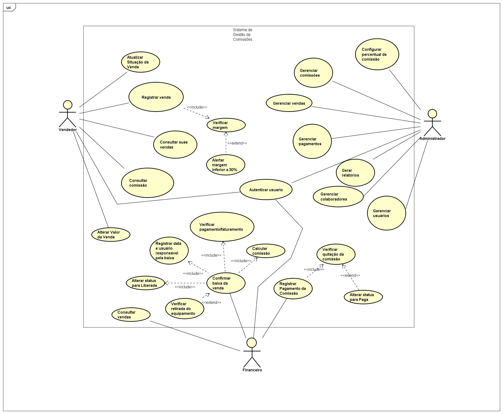
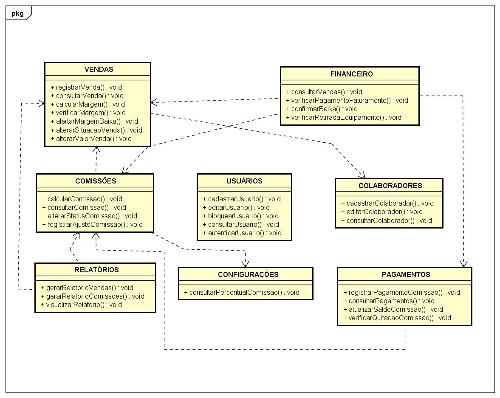
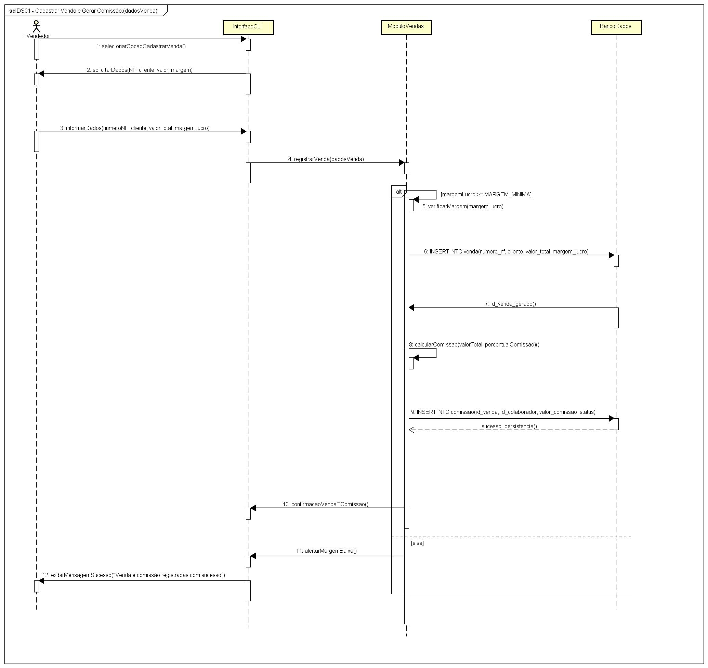
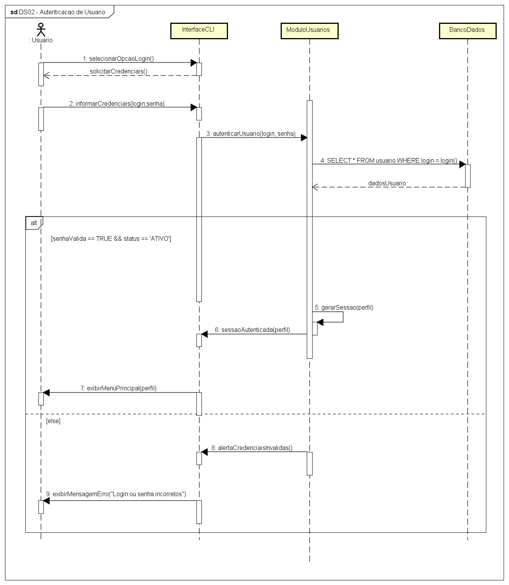
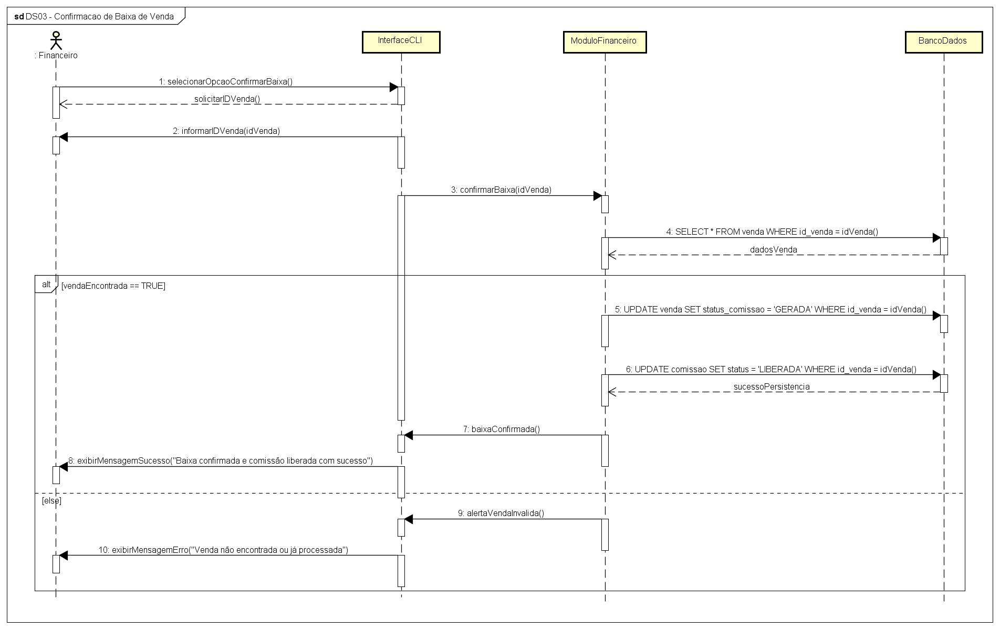
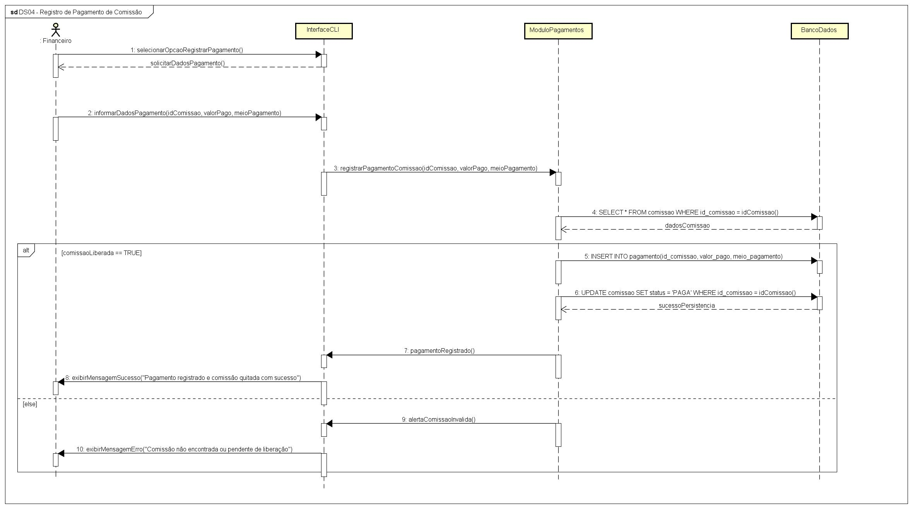

# Diagramas do Sistema

Esta seção reúne os principais diagramas desenvolvidos para o **Sistema de Gestão de Comissões — Hitek Informática**.

Os diagramas representam diferentes perspectivas do sistema:

- interação entre usuários e funcionalidades;
- organização dos módulos e funções do sistema;
- fluxo temporal de mensagens entre componentes e banco de dados.

---

## Diagrama de Casos de Uso

O Diagrama de Casos de Uso apresenta os atores do sistema e as funcionalidades com as quais cada perfil interage.

Os atores definidos são:

- Vendedor;
- Financeiro;
- Administrador.

Entre as principais funcionalidades representadas estão:

- autenticação de usuário;
- registro e consulta de vendas;
- atualização da situação da venda pelo Vendedor;
- alteração do valor da venda pelo Vendedor;
- consulta de comissões;
- confirmação de baixa pelo Financeiro;
- registro de pagamento da comissão;
- gerenciamento de usuários;
- gerenciamento de colaboradores;
- gerenciamento de vendas;
- gerenciamento de comissões;
- gerenciamento de pagamentos;
- geração de relatórios;
- configuração do percentual de comissão.

O Vendedor poderá atualizar a situação da venda e alterar o valor da venda, mas não poderá alterar o valor de custo.

A atualização da situação da venda não substitui a validação realizada pelo Financeiro, que continua responsável pela confirmação da baixa.

O diagrama também utiliza os relacionamentos `<<include>>` e `<<extend>>` quando aplicáveis.

### Visualização



[Ver imagem em tamanho original](casos-de-uso.png)

---

## Diagrama Estendido

O Diagrama Estendido apresenta a organização funcional do sistema por meio de módulos e suas respectivas funções.

Os módulos definidos são:

- Vendas;
- Financeiro;
- Comissões;
- Usuários;
- Colaboradores;
- Pagamentos;
- Relatórios;
- Configurações.

O objetivo desse diagrama é representar como as principais funcionalidades do sistema estão organizadas e relacionadas.

### Módulo Vendas

Entre as funções representadas no módulo de Vendas estão:

```text
registrarVenda(): void
consultarVenda(): void
alterarSituacaoVenda(): void
alterarValorVenda(): void
calcularMargem(): void
verificarMargem(): void
alertarMargemBaixa(): void
```

As funções:

```text
alterarSituacaoVenda()
alterarValorVenda()
```

foram incluídas para representar as novas permissões definidas para o perfil Vendedor.

A alteração do valor de custo não está disponível para esse perfil.

### Principais dependências

As principais dependências entre os módulos são:

```text
VENDAS → COLABORADORES

FINANCEIRO → VENDAS
FINANCEIRO → COMISSÕES
FINANCEIRO → PAGAMENTOS

COMISSÕES → CONFIGURAÇÕES
COMISSÕES → VENDAS

PAGAMENTOS → COMISSÕES

RELATÓRIOS → VENDAS
RELATÓRIOS → COMISSÕES
```

### Visualização



[Ver imagem em tamanho original](estendido.png)

---

## Diagramas de Sequência

Os Diagramas de Sequência apresentam a troca de mensagens, a ordem cronológica das chamadas de funções e as interações entre os Atores, as Interfaces CLI, os Módulos do Sistema e o Banco de Dados.

Estão definidos 4 diagramas de sequência principais:

- **DS01:** Cadastrar Venda e Gerar Comissão;
- **DS02:** Autenticação de Usuário;
- **DS03:** Confirmação de Baixa de Venda;
- **DS04:** Registro de Pagamento de Comissão.

---

### DS01 — Cadastrar Venda e Gerar Comissão

Apresenta a interação do **Vendedor** na inclusão de uma nova venda, a verificação da margem de lucro mínima e a inserção encadeada da venda e da comissão no banco de dados.

Entre os elementos e trocas representados estão:

- solicitação e envio de dados da Nota Fiscal, cliente, valor e margem;
- verificação da margem mínima (`margemLucro >= MARGEM_MINIMA`);
- persistência em banco da venda (`INSERT INTO venda`) e obtenção do ID gerado;
- cálculo do valor da comissão e gravação (`INSERT INTO comissao`);
- tratamento de margem baixa no bloco condicional.

#### Visualização



[Ver imagem em tamanho original](ds01-cadastrar-venda.png)

---

### DS02 — Autenticação de Usuário

Apresenta o fluxo de acesso ao sistema por qualquer perfil de **Usuário**, cobrindo o envio das credenciais, a consulta na base de dados e a criação de sessão.

Entre os elementos e trocas representados estão:

- seleção de login e fornecimento de credenciais (`login`, `senha`);
- consulta no banco (`SELECT * FROM usuario WHERE login = login()`);
- validação de senha e status da conta (`senhaValida == TRUE && status == 'ATIVO'`);
- geração de sessão e apresentação do menu principal de acordo com o perfil;
- alarme e mensagem de erro para credenciais inválidas ou inativas.

#### Visualização



[Ver imagem em tamanho original](ds02-autenticacao-usuario.png)

---

### DS03 — Confirmação de Baixa de Venda

Apresenta a ação executada pelo perfil **Financeiro** para homologar a baixa de uma venda realizada e liberar a comissão correspondente.

Entre os elementos e trocas representados estão:

- inserção do `idVenda` pelo perfil Financeiro;
- consulta de existência da venda na base de dados (`SELECT * FROM venda WHERE id_venda = idVenda()`);
- atualização do status da comissão na venda (`UPDATE venda SET status_comissao = 'GERADA'`);
- alteração do status da comissão para liberada (`UPDATE comissao SET status = 'LIBERADA'`);
- tratamento para vendas inexistentes ou inconsistentes.

#### Visualização



[Ver imagem em tamanho original](ds03-confirmacao-baixa.png)

---

### DS04 — Registro de Pagamento de Comissão

Apresenta a liquidação financeira efetuada pelo **Financeiro**, registrando o pagamento da comissão previamente liberada.

Entre os elementos e trocas representados estão:

- fornecimento dos dados do pagamento (`idComissao`, `valorPago`, `meioPagamento`);
- verificação de liberação prévia (`comissaoLiberada == TRUE`);
- gravação do registro (`INSERT INTO pagamento`);
- quitação do status da comissão (`UPDATE comissao SET status = 'PAGA'`);
- exibição de confirmação ou mensagem de erro se a comissão estiver pendente de liberação.

#### Visualização



[Ver imagem em tamanho original](ds04-registro-pagamento.png)

---

## Arquivo editável

O arquivo editável dos diagramas desenvolvidos no Astah também poderá ser armazenado nesta pasta.

Arquivo previsto:

```text
sistema-comissoes.asta
```

Esse arquivo permite abrir e editar os diagramas diretamente no Astah UML.

---

## Arquivos da seção

```text
03-diagramas/
├── README.md
├── casos-de-uso.png
├── estendido.png
├── ds01-cadastrar-venda-e-gerar-comissao.png
├── ds02-autenticacao-de-usuario.png
├── ds03-confirmacao-de-baixa-de-venda.png
├── ds04-registro-de-pagamento-de-comissao.png
└── sistema-comissoes.asta
```

---

## Relação entre os diagramas

Cada diagrama apresenta uma visão diferente do sistema:

| Diagrama | Objetivo |
|---|---|
| Casos de Uso | Mostrar quem utiliza o sistema e quais funcionalidades cada ator pode executar |
| Estendido | Mostrar como o sistema está organizado em módulos, funções e dependências |
| Sequência (DS01 a DS04) | Mostrar o fluxo temporal de troca de mensagens, validações e persistências entre atores, módulos e banco de dados |

---

## Documentação relacionada

- [Casos de Uso](../02-engenharia-de-software/casos-de-uso.md)
- [Arquitetura do Sistema](../02-engenharia-de-software/arquitetura.md)
- [Regras de Negócio](../01-visao-geral/regras-de-negocio.md)

---

[← Voltar ao README principal](../../README.md)
