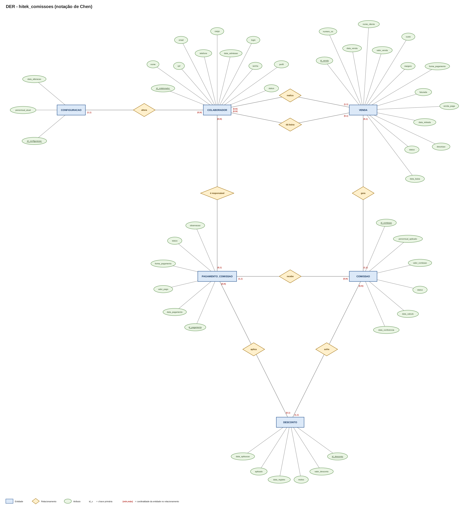

# Banco de Dados

Esta seção reúne a documentação relacionada ao banco de dados do **Sistema de Gestão de Comissões — Hitek Informática**.

O banco de dados é responsável por armazenar as informações necessárias para o funcionamento do sistema, incluindo dados relacionados a usuários, colaboradores, vendas, comissões, pagamentos, configurações e ajustes.

---

## Objetivo 

O objetivo da modelagem de dados é estruturar as informações do sistema de forma organizada, permitindo:

- armazenamento consistente dos dados;
- relacionamento entre as principais entidades;
- redução de redundâncias;
- realização de consultas;
- acompanhamento das vendas e comissões;
- registro dos pagamentos;
- controle das situações relacionadas às vendas;
- manutenção do histórico necessário ao sistema.

---

## Etapas da modelagem

A documentação do banco de dados está organizada nas seguintes etapas:

### Modelo Conceitual

Representa as principais entidades do sistema e seus relacionamentos, sem depender diretamente de um SGBD específico.

[Ver modelo conceitual](modelo-conceitual.md)

### Modelo Lógico

Apresenta a transformação do modelo conceitual em uma estrutura baseada em tabelas, atributos, chaves primárias e chaves estrangeiras.

[Ver modelo lógico](modelo-logico.md)

### Modelo Físico

Apresenta a estrutura utilizada para implementação do banco de dados no MySQL.

[Ver modelo físico](modelo-fisico.md)

### Normalização

Documenta a análise das tabelas de acordo com as formas normais utilizadas no projeto (1FN, 2FN e 3FN).

[Ver normalização](normalizacao.md)

---

## Principais informações do sistema

A modelagem contempla informações relacionadas a:

- usuários e perfis de acesso;
- colaboradores;
- vendas (valor comercial, valor de custo, situação de pagamento/faturamento, retirada de equipamento, baixa financeira);
- comissões e histórico de status (Pendente, Liberada, Paga);
- pagamentos parciais e controle de saldo;
- configurações globais (percentual padrão de comissão);
- ajustes e descontos aplicados;
- histórico e auditoria das operações.

---

## Permissões e integridade dos dados

O banco de dados armazena os dados necessários ao funcionamento das regras de acesso definidas pelo sistema.

As permissões são controladas pela aplicação de acordo com o perfil do usuário:

* **Vendedor:** Pode cadastrar vendas, atualizar a situação da venda e alterar o valor comercial. Não pode alterar o valor de custo nem confirmar a baixa da venda.
* **Financeiro:** Responsável por verificar informações de pagamento/faturamento, validar a retirada do equipamento, confirmar a baixa da venda e registrar pagamentos de comissões.
* **Administrador:** Acesso total a configurações de percentual, gestão de colaboradores/usuários, relatórios e ajustes.

---

## DER (Diagrama Entidade-Relacionamento)

O Diagrama Entidade-Relacionamento final do sistema Hitek Informática encontra-se disponível abaixo:



*(Arquivo fonte e modelo relacional disponíveis na pasta `/database/`)*

---

## Scripts SQL

Os scripts DDL/DML utilizados para criação e povoamento do banco de dados MySQL estão localizados na pasta:

```text
/database/BD-hitek-comissoes.sql
